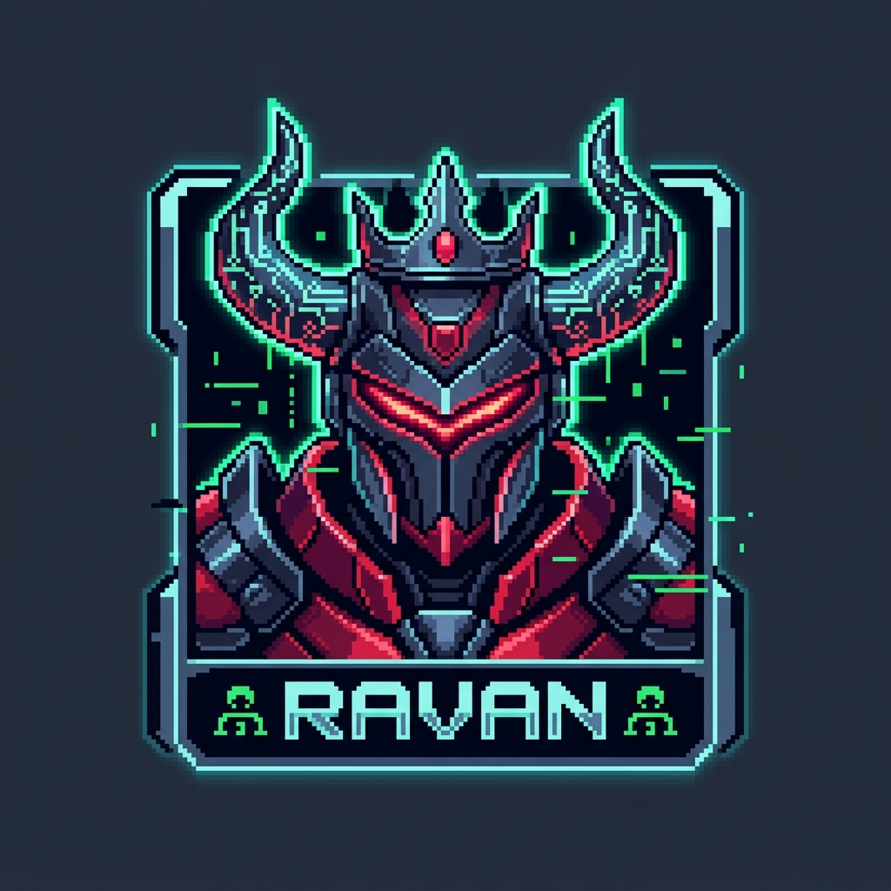

# RAVAN // AUTONOMOUS CYBERSECURITY AI AGENT

<p align="center">
  
  <br>
  <em>Autonomous 16-Bit Offensive Cyber-Intelligence Terminal Agent | OpenRouter x HexStrike FastMCP</em>
</p>

<p align="center">
  
  
  
  
  
</p>

---

## Overview

**RAVAN** is an elite terminal-native, autonomous cybersecurity AI agent designed for authorized penetration testing, vulnerability assessment, bug bounty hunting, and binary analysis.

Integrated with **OpenRouter** for multi-model LLM reasoning (Claude 3.5 Sonnet, DeepSeek R1/Chat, GPT-4o, Llama 3.3) and **HexStrike FastMCP** (150+ automated security tools), RAVAN operates with complete autonomy. It autonomously surfs target scopes, uncovers attack surfaces, identifies business logic risks, executes security tools in a continuous feedback loop, and produces comprehensive, evidence-backed security reports formatted to professional **HackerOne Security Advisory** standards.

---

## Key Features

- **Dual Engine: Cloud API or 100% Local Uncensored LLM**:
  - **Cloud AI API**: OpenRouter, OpenAI (ChatGPT), Anthropic Claude, Google Gemini, or any custom OpenAI-compatible endpoint with custom Base URL.
  - **Local AirLLM Engine**: Runs uncensored open models locally on hardware with layer-by-layer memory offloading, allowing 8B models to run smoothly even on 8GB systems without out-of-memory errors.
  - **System Specs Gate**: Automatically audits RAM, CPU cores, and GPU; refuses local execution if RAM <= 4GB to prevent system freezes.
  - **Custom Model Directory**: Drop any `.gguf` or HuggingFace model directly into `models/` for immediate discovery.
- **100% Autonomous Hands-Off Execution**: Zero confirmation loops. Once given an assessment objective, RAVAN executes tools, analyzes output, pivots based on discovered findings, and delivers final reports without asking permission.
- **Deep Web Surfing & Business Logic Profiling**: Analyzes web targets to identify company business models (E-Commerce, FinTech, SaaS, Healthcare) and automatically tailors vulnerability discovery toward critical business logic vectors (e.g., cart tampering, BOLA/IDOR, payment bypasses, PostMessage wildcards).
- **Automated Scope Extraction**: Parses bug bounty programs (HackerOne, Bugcrowd, private disclosure policies) to instantly extract in-scope wildcard domains (`*.target.com`), out-of-scope targets, APIs, and client-side technology stacks.
- **HexStrike FastMCP Integration (150+ Tools)**:
  - **Recon & Discovery**: `httpx`, `subfinder`, `amass`, `katana`, `dirb`, `ffuf`, `arjun`, `dnsenum`, `wafw00f`.
  - **Vulnerability Auditing**: `nuclei`, `sqlmap`, `dalfox`, `jaeles`, `wfuzz`, `nikto`, `wpscan`.
  - **Binary & Malware Analysis**: `radare2`, `binwalk`, `checksec`, `strings`, `ropgadget`, `volatility`.
  - **Network & Infrastructure**: `nmap`, `masscan`, `rustscan`, `enum4linux`, `netexec`, `hydra`.
- **HackerOne Standard Reporting**: Every assessment generates a structured `.md` advisory matching industry bug bounty disclosure standards (CVSS 3.1 scoring, Root Cause, Bundle/Endpoint Analysis, Runnable PoC, and Remediation Guidelines).
- **Dynamic Multi-Model Switching**: Seamlessly change LLM backends on the fly (`/model deepseek`, `/model claude`, `/model gpt4`) to leverage different reasoning strengths.
- **Cyberpunk Terminal UI**: Styled terminal interface built with Rich ANSI formatting, live execution spinners, telemetry logs, and interactive command prompts.

---

## Architecture Pipeline

```
┌────────────────────────────────────────────────────────┐
│                      USER PROMPT                       │
│       e.g., "Audit api.target.com for critical bugs"   │
└──────────────────────────┬─────────────────────────────┘
                           │
                           ▼
┌────────────────────────────────────────────────────────┐
│                   STAGE 1: SURF & OSINT                │
│  • web_surf_target: Crawls scope, headers, postMessage │
│  • web_search_osint: Gathers past CVEs and writeups    │
│  • Business Logic Classification (FinTech, SaaS, etc.) │
└──────────────────────────┬─────────────────────────────┘
                           │
                           ▼
┌────────────────────────────────────────────────────────┐
│              STAGE 2: AUTONOMOUS RECON & TOOLS         │
│  • HexStrike FastMCP: httpx, subfinder, nuclei, etc.   │
│  • Dynamic Tool Chaining & Output Parsing              │
└──────────────────────────┬─────────────────────────────┘
                           │
                           ▼
┌────────────────────────────────────────────────────────┐
│               STAGE 3: TRIAGE & REPORTING              │
│  • HackerOne Security Advisory Formatting              │
│  • CVSS 3.1 Vector & Root Cause Technical Breakdown    │
│  • Auto-saved to reports/hackerone_report_*.md         │
└────────────────────────────────────────────────────────┘
```

---

## Installation & Setup

### Prerequisites

- Linux (Ubuntu/Debian, Arch, Kali, Fedora)
- Python 3.10+
- Git & Curl
- [Optional] Running HexStrike Server on port `8888` (for the 150+ security tools suite)

### 1. Clone the Repository

```bash
git clone https://github.com/MADHacker912/ravan.git
cd ravan
```

### 2. Install Dependencies & CLI Alias

Run the automated installer:

```bash
./install.sh
```

This installs Python dependencies and creates a global `ravan` symlink in `~/.local/bin/`.

Alternatively, install dependencies manually:

```bash
pip install -r requirements.txt
```

### 3. Launch Agent

From anywhere in your terminal, run:

```bash
ravan
```

*(Or use the direct launch script: `./run.sh`)*

---

## Configuration & First-Time Setup Wizard

On your first run (or anytime by executing `/setup`), RAVAN launches an interactive Setup Wizard:

1. **Option [1] Cloud AI API**:
   - **OpenRouter** (Default / Recommended — Claude 3.5 Sonnet, DeepSeek, GPT-4o, Llama 3)
   - **OpenAI** (ChatGPT / GPT-4o / o1)
   - **Anthropic Claude** (Claude API / Compatible)
   - **Google Gemini** (OpenAI-compatible endpoint)
   - **Custom / Other Provider** (Custom Base URL + API Key for Ollama, vLLM, Groq, Mistral)

2. **Option [2] Local Uncensored LLM**:
   - Performs a hardware audit (RAM, CPU cores, CUDA).
   - If Total RAM <= 4GB: Local execution is blocked to prevent OOM; prompts to use Cloud API.
   - If Total RAM > 4GB: Curates 3 top uncensored cyber models:
     - `Dolphin 2.9 Llama-3 8B` (Abliterated / Offensive Security) ~4.5 GB
     - `Qwen 2.5 Coder 7B` (Abliterated / Exploit & Script Auditing) ~4.4 GB
     - `Llama 3.2 3B Instruct` (Uncensored / Fast Lightweight) ~2.0 GB
   - Prompts for download confirmation, downloads into `models/` with progress tracking.
   - Users can drop custom models into `models/` for auto-discovery.
   - Powered by **AirLLM** for memory-efficient layer-by-layer offloading.

Settings are saved in `~/.hex_agent.env`:

```env
PROVIDER_TYPE="api" # "api" or "local"
API_PROVIDER="openrouter" # openrouter, openai, claude, gemini, custom
API_KEY="sk-or-v1-xxxxxxxx"
API_BASE_URL="https://openrouter.ai/api/v1"
DEFAULT_MODEL="anthropic/claude-3.5-sonnet"
LOCAL_MODEL_NAME=""
LOCAL_MODEL_PATH=""
LOCAL_BACKEND="airllm"
HEXSTRIKE_SERVER="http://127.0.0.1:8888"
DEFAULT_MODE="bugbounty"
```

### Supported Model Aliases

You can reference models using short aliases:
- `claude` / `sonnet` -> `anthropic/claude-3.5-sonnet`
- `deepseek` / `deepseek-chat` -> `deepseek/deepseek-chat`
- `r1` / `deepseek-r1` -> `deepseek/deepseek-r1`
- `gpt4` / `gpt-4o` -> `openai/gpt-4o`
- `llama` -> `meta-llama/llama-3.3-70b-instruct`
- `gemini` -> `google/gemini-2.0-flash-exp:free`

---

## Terminal Slash Commands

Control operational modes and models directly from the interactive prompt:

| Command | Description |
|---|---|
| `/mode <name>` | Switch active toolset profile (`bugbounty`, `malware`, `essential`, `all`) |
| `/model <id>` | Switch OpenRouter LLM backend dynamically |
| `/tools` | List all active HexStrike MCP tools loaded in the current mode |
| `/key` | Update or change OpenRouter API Key |
| `/clear` | Clear the current conversation context |
| `/help` | Display command help sheet |
| `/exit` | Exit RAVAN agent |

---

## Example Usage

### 1. Web Target Recon & Scope Extraction
```text
╭─[ RAVAN | anthropic/claude-3.5-sonnet | BUGBOUNTY ]
╰─❯ Surf target https://example.com, discover in-scope assets, audit response headers, and check for missing CSP frame-ancestors.
```

### 2. Targeted Vulnerability Probing
```text
╭─[ RAVAN | deepseek/deepseek-chat | BUGBOUNTY ]
╰─❯ Execute a nuclei scan against https://api.target.com focusing on high and critical templates, and search for exposed API parameters with arjun.
```

### 3. Binary Static Analysis
```text
╭─[ RAVAN | openai/gpt-4o | MALWARE ]
╰─❯ Analyze the ELF binary at /tmp/suspicious_sample. Run checksec, extract printable strings, and inspect architecture headers.
```

---

## HackerOne Report Structure

Reports are automatically generated and saved to `reports/` following the format:

```markdown
# Security Report: <Descriptive Vulnerability Title>

**Program:** Target Scope Assessment  
**Asset:** `target.com`  
**Severity:** High (CVSS:3.1/AV:N/AC:L/PR:N/UI:R/S:U/C:H/I:N/A:N — Score: 6.5)  
**Weakness:** CWE-1021 (Improper Restriction of Rendered UI Layers)  
**Researcher Verification:** `X-HackerOne-Research: obito_gupta`  

## 1. Summary
[Executive summary of the issue]

## 2. Technical Analysis & Root Cause
### 2.1 Bundle / Endpoint Inspection
### 2.2 Response Header Audit

## 3. Impact
- Threat vectors and exploitation consequences

## 4. Steps to Reproduce
### Step 1: PoC Setup (HTML / curl / Python)
### Step 2: Verification

## 5. Remediation Guidelines
## 6. References
## 7. Automated Tool Telemetry
```

---

## Disclaimer

> **IMPORTANT**: RAVAN is engineered strictly for authorized security assessments, penetration testing, bug bounty hunting, and educational research on systems you own or have explicit, documented permission to test. Unauthorized access or attacks against systems without prior consent is illegal. Users are solely responsible for ensuring compliance with all applicable local, national, and international laws.

---

## License

This project is licensed under the MIT License - see the [LICENSE](LICENSE) file for details.
